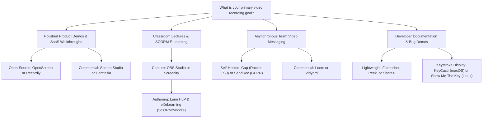

# 🎥 Awesome Video Screen Recording & E-Learning 🎓

**A carefully curated ecosystem of commercial SaaS tools, open-source software, and developer frameworks for high-fidelity screen recording, asynchronous video messaging, browser capture, and interactive e-learning course authoring.**

*Last updated: March 2026*

---

## 📑 Table of Contents

- [🌟 Introduction & Ecosystem Scope](#-introduction--ecosystem-scope)
- [📊 Sector Overview & Market Dynamics](#-sector-overview--market-dynamics)
- [🏢 SaaS & Hosted Commercial Platforms](#-saas--hosted-commercial-platforms)
- [💻 Open-Source Repositories (Ranked by Stars)](#-open-source-repositories-ranked-by-stars)
- [🎯 Recommended Stacks by Use Case](#-recommended-stacks-by-use-case)
- [🔍 Feature Comparison & Architecture Matrix](#-feature-comparison--architecture-matrix)
- [🤝 How to Contribute](#-how-to-contribute)
- [☕ Support & Sponsorship](#-support--sponsorship)
- [⭐ Star History](#-star-history)
- [📜 Disclaimer](#-disclaimer)

---

## 🌟 Introduction & Ecosystem Scope

Modern digital collaboration and education depend on two foundational workflows:
1. **Screen Capture & Video Production:** Recording crisp desktop sessions, webcam feeds, system audio, and keyboard/mouse interactions with automated cursor zooms, background framing, and instant sharing.
2. **Interactive E-Learning Authoring:** Transforming raw screencasts and presentations into structured educational assets equipped with SCORM/xAPI packaging, LMS integration (Moodle/Canvas/Blackboard), branching scenarios, and embedded knowledge-check quizzes.

Whether you are looking for an enterprise **Loom alternative**, a professional **Camtasia replacement**, a zero-cost **Screen Studio alternative for Linux and Windows**, or a **self-hosted, GDPR-compliant async video platform**, this directory catalogs the absolute best options across both SaaS and open-source models.

---

## 📊 Sector Overview & Market Dynamics

The global video screen recording and screencasting software market was valued at **$1.45 Billion in 2024** and is projected to expand at a **Compound Annual Growth Rate (CAGR) of 15.2%**, surpassing **$3.8 Billion by 2031**, alongside the rapidly growing **$2.3 Billion interactive e-learning authoring tools** sector.

The market displays a **moderately fragmented** competitive dynamic:
- **Enterprise Concentration:** The enterprise async video messaging and high-end tutorial authoring spaces show clear signs of consolidation around category-defining market leaders (demonstrated by Atlassian's **$975M acquisition of Loom** and private equity recapitalizations of TechSmith).
- **Creator & Open-Source Long Tail:** Conversely, desktop screencasting, lightweight browser extensions, and indie authoring utilities remain **highly fragmented**. Rising subscription fatigue and heightened GDPR/biometric privacy concerns have triggered rapid adoption of **self-hosted, open-source alternatives** (such as Cap, Recordly, and OpenScreen) that empower teams to retain 100% control over their video data and eliminate recurring per-seat fees.

---

## 🏢 SaaS & Hosted Commercial Platforms

The table below catalogs leading commercial SaaS products and desktop video recording suites. Entries are sorted descending by company size (valuation / estimated market capitalization / revenue).

| 🏷️ Platform | 🏢 Company Size (Valuation / Revenue) | 💰 Starting Pricing | 🆓 Free Tier / Free Trial Limits | 🚀 Primary Focus & Key Differentiators |
|:---|:---|:---|:---|:---|
| [**Loom**](https://www.loom.com/) | **~$56 Billion Market Cap** (Acquired for $975M by Atlassian; TEAM: ~$4B+ ARR) | **$12.50/creator/mo** (billed annually) or $15.00/mo (monthly) | **Free Forever plan**: Capped at 25 videos per workspace, 5 minutes max per video, and 720p resolution | The reference async video messaging platform with instant cloud link generation, viewer completion analytics, transcript-based editing, and seamless workspace integrations. |
| [**Wondershare DemoCreator**](https://democreator.wondershare.com/) | **~$1.1 Billion Market Cap** (SZ: 300624; ~$210M annual revenue) | **$45.00/year** subscription or $65.00 one-time perpetual license | **Free trial with watermark**: Unrestricted trial duration, but includes watermark on all video exports, 10-minute export cap, and 720p maximum resolution | An all-in-one desktop screen recorder and video suite featuring virtual avatar presentations, cursor highlight animations, green screen removal, and multi-track timeline editing. |
| [**Descript**](https://www.descript.com/) | **~$550 Million Valuation** (~$55M ARR; backed by OpenAI Startup Fund & a16z) | **$16.00/user/mo** (billed annually) or $24.00/mo (monthly) | **Free Forever plan**: 60 minutes of transcription/month, 1 watermark-free 720p export/month (additional exports carry Descript watermark), 100 AI credits | Pioneer of script-based editing: edit screen recordings by editing text, removing filler words automatically, and generating AI voiceovers and Studio Sound noise cancellation. |
| [**TechSmith Camtasia**](https://www.techsmith.com/camtasia.html) | **~$500 Million Valuation** (~$75M–$100M ARR; backed by TA Associates) | **$179.88/year** for Essentials plan (or $249.00/year for Create plan) | **30-day free trial**: Complete access to all features during the 30 days, but embeds a TechSmith watermark across all exported videos | The gold standard for professional instructional screencasting, featuring rich timeline zooms, callouts, interactive SCORM-compatible video quizzes, and audio leveling. |
| [**TechSmith Snagit**](https://www.techsmith.com/snagit.html) | **~$500 Million Valuation** (~$75M–$100M ARR; backed by TA Associates) | **$39.00/year** annual subscription for individual license | **15-day free trial**: Fully functional trial with full access to all capture tools, video-to-GIF exports, and watermark-free exports (no credit card required) | The premier lightweight screen capture and documentation recorder for fast bug reports, step-by-step visual guides, scrolling window captures, and micro-video demonstrations. |
| [**Vidyard**](https://www.vidyard.com/) | **~$150M – $200M Valuation** (~$40M ARR; $95M venture funding) | **$59.00/seat/mo** (billed annually) or $89.00/mo (monthly) | **Free Forever plan**: Capped at 5 video uploads/month, 15 lifetime AI-generated videos, standard video share pages, and basic viewer counts | Enterprise video messaging platform optimized for B2B sales pipelines, direct CRM sync (Salesforce, HubSpot), viewer engagement drop-off tracking, and custom branded video hubs. |
| [**Screencastify**](https://www.screencastify.com/) | **~$80M – $100M Valuation** (~$9.5M ARR; Series A funded) | **$7.00/user/mo** (billed annually) or $19.00/mo (monthly) | **Free Forever plan**: Capped at 10 videos stored in cloud library, 30-minute max recording length per video, 1080p, with watermarked YouTube exports | Browser-native Chrome extension built for K-12 and university education with Google Classroom integrations, embedded interactive question checks, and zero desktop installation. |
| [**Screen Studio**](https://www.screen.studio/) | **~$15 Million Valuation** (~$3.5M ARR; bootstrapped indie software) | **$89.00 one-time** perpetual license for 1 Mac (includes 1 year of updates) | **Free trial (unlimited duration)**: All editing features available to test locally, but exported MP4 and GIF videos carry a Screen Studio watermark | macOS screen recorder that produces demo videos with automated cursor smoothing, dynamic camera pans, synthetic motion blur, and gradient backgrounds. |

---

## 💻 Open-Source Repositories (Ranked by Stars)

The following open-source solutions provide self-hostable video recording, native GPU-accelerated screencasting, and e-learning authoring tools. Each repository is badged with real-time GitHub stars (linking directly to its stargazers) and sorted in **descending order by star count**.

### 1. 🎥 [OBS Studio](https://obsproject.com/) 
- **License:** GPL-2.0 📜
- **Primary Platform:** Windows, macOS, Linux 🖥️
- **Highlights:** The industry benchmark for open-source high-performance video recording and live streaming. Features high-performance real-time video/audio capturing, scene compositions, GPU-hardware encoding (NVENC, AMD AMF, QuickSync, Apple Silicon VT), audio mixing with VST plugins, and modular plugin support. While not optimized for automated cursor zooms, it serves as the ultimate high-fidelity capture pipeline for tutorials and presentations.

### 2. 📸 [ShareX](https://getsharex.com/) 
- **License:** GPL-3.0 📜
- **Primary Platform:** Windows 🪟
- **Highlights:** Over 17 years of active development. Provides screen recording (via FFmpeg), animated GIF capture, scrolling screenshot capture, OCR text recognition, visual annotations, and direct upload pipelines to over 80 file-hosting destinations (S3, Dropbox, Google Drive, Imgur, custom endpoints).

### 3. 🎬 [Recordly](https://github.com/webadderallorg/Recordly) 
- **License:** AGPL-3.0 📜
- **Primary Platform:** macOS, Windows, Linux 🌐
- **Highlights:** A modern open-source Screen Studio alternative featuring automated cursor smoothing, motion blur, click-bounce animations, cursor sizing adjustments, webcam round overlays, timeline zooms, speed regions, and gradient wallpapers. Exports crisp demo videos with `.recordly` project persistence.

### 4. 🔥 [Flameshot](https://flameshot.org/) 
- **License:** GPL-3.0 📜
- **Primary Platform:** Linux, Windows, macOS 🐧
- **Highlights:** Powerful yet lightweight screen capture tool with on-screen drawing, text callouts, arrow annotations, step-number markers (1, 2, 3), and blur/pixelate tools for masking sensitive student/customer data during tutorial creation.

### 5. 🧢 [Cap](https://cap.so/) 
- **License:** AGPL-3.0 📜
- **Primary Platform:** macOS, Windows, Linux, Web / Docker 🐳
- **Highlights:** The premier open-source Loom alternative. Features **Instant Mode** (streams uploads in real time as you record for zero-delay sharing) and **Studio Mode** (local timeline editing, automated captions, zooms, and custom backgrounds). Full self-hosting via Docker Compose with your own S3-compatible storage (MinIO, Cloudflare R2, AWS S3).

### 6. 🖍️ [Screenity](https://screenity.io/) 
- **License:** GPL-3.0 📜
- **Primary Platform:** Google Chrome & Chromium Browsers 🌐
- **Highlights:** The leading open-source browser-native screen recorder and annotation tool. Annotate anywhere on screen during recording, draw lines, add shapes, highlight clicks, mute system audio, record tabs or full desktop, and export to MP4, WebM, or GIF with zero watermarks.

### 7. ⌨️ [KeyCastr](https://github.com/keycastr/keycastr) 
- **License:** BSD-3-Clause 📜
- **Primary Platform:** macOS 🍏
- **Highlights:** Open-source keystroke visualizer for instructional videos, live coding demos, and presentations. Displays customizable on-screen visual badges whenever keyboard shortcuts or typing sequences are executed, ensuring students never miss hotkey combinations.

### 8. 📡 [Screego](https://screego.net/) 
- **License:** GPL-3.0 📜
- **Primary Platform:** Self-Hosted Go Binary / Docker 🐳
- **Highlights:** Lightweight self-hosted screen-sharing server built with WebRTC. Designed for developers and educators to share screens with low latency, integrated voice chat, multi-user rooms, and end-to-end data control without relying on third-party cloud conferencing.

### 9. 🐣 [Peek](https://github.com/phw/peek) 
- **License:** GPL-3.0 📜
- **Primary Platform:** Linux (X11 / Wayland) 🐧
- **Highlights:** An animated GIF and lightweight video screen recorder featuring an adjustable frame overlay window. Place the frame over any UI component, click Record, and produce crisp GIF/WebM/MP4 clips perfect for documentation and GitHub pull request walkthroughs.

### 10. ⚡ [OpenScreen](https://getopenscreen.com/) 
- **License:** MIT 📜
- **Primary Platform:** macOS (ScreenCaptureKit), Windows (Windows Graphics Capture), Linux (PipeWire) 💻
- **Highlights:** Fast, GPU-accelerated Screen Studio alternative. Offers click-based dynamic zooms, timeline editing, speed regions, background padding, and local Whisper-powered transcription. Features an **MCP (Model Context Protocol) server and CLI** for programmatic, AI-agent-driven screen recording.

### 11. 🐹 [Kooha](https://github.com/SeaDve/Kooha) 
- **License:** GPL-3.0 📜
- **Primary Platform:** Linux (GTK4 / Libadwaita / Wayland & X11) 🐧
- **Highlights:** Minimalist, modern screen recorder built for GNOME and Linux desktops. Clean UI, hardware-accelerated encoding, webcam overlay, area capture, system audio and mic recording, and quick export to MP4, WebM, and GIF formats.

### 12. 📼 [SimpleScreenRecorder (SSR)](https://www.maartenbaert.be/simplescreenrecorder/) 
- **License:** GPL-3.0 📜
- **Primary Platform:** Linux 🐧
- **Highlights:** Classic, battle-tested screen recorder for Linux desktop systems. Known for rock-solid audio/video synchronization, multi-threading optimizations, OpenGL frame capture, and low system overhead during long technical lectures.

### 13. 💧 [Screendrop](https://github.com/fayazara/Screendrop) 
- **License:** MIT 📜
- **Primary Platform:** macOS 🍏
- **Highlights:** Native macOS screen recorder with a built-in **teleprompter**, on-device Whisper transcription, non-destructive session recording packages, instant video trim, and local shareable video links.

### 14. 🎙️ [vokoscreenNG](https://vokoscreen.volker-krause.de/) 
- **License:** GPL-2.0 📜
- **Primary Platform:** Linux, Windows 🖥️
- **Highlights:** User-friendly GUI screen recorder powered by Qt and GStreamer. Supports full screen, window, or custom area recording, magnifier loupe effect, click animations, and multiple audio source inputs.

### 15. 🔑 [Show Me The Key](https://github.com/AlynxZhou/showmethekey) 
- **License:** Apache-2.0 📜
- **Primary Platform:** Linux (libinput / Wayland & X11) 🐧
- **Highlights:** Screenkeys utility for Linux screencasters and online tutors. Intercepts raw input via `libinput` to display keyboard presses and mouse clicks directly on screen with full Wayland compositing support.

### 16. 📚 [H5P (Lumi Desktop Editor)](https://lumi.education/) 
- **License:** GPL-3.0 📜
- **Primary Platform:** Windows, macOS, Linux, Web 🎓
- **Highlights:** Offline desktop authoring tool for **H5P interactive content**. Turn screen recordings into interactive videos with embedded timestamped quizzes, drag-and-drop questions, and branching scenarios. Exports directly to standalone HTML and SCORM 1.2 packages compatible with Moodle, Canvas, and Blackboard.

### 17. 🎓 [eXeLearning](https://exelearning.net/) 
- **License:** GPL-2.0 📜
- **Primary Platform:** Windows, Linux, macOS, Docker 🐳
- **Highlights:** Supported by Spain’s Ministry of Education (INTEF). Free open-source authoring tool to generate structured interactive learning resources (Open Educational Resources - OER). Supports hierarchical unit outlines, iDevices (interactive exercises), real-time collaborative editing via Yjs WebSockets, and exports to SCORM 1.2, SCORM 2004, IMS, and standalone web pages.

### 18. 🛡️ [SendRec](https://github.com/sendrec/sendrec) 
- **License:** AGPL-3.0 📜
- **Primary Platform:** Docker / Self-Hosted Web App 🐳
- **Highlights:** GDPR-first self-hosted Loom alternative. Built for European institutions requiring local data residency. Offers browser-native recording across Chrome, Safari, and Firefox, password-protected video links, self-hosted Whisper transcription, viewer completion funnels (25%/50%/75%/100%), and webhooks.

### 19. 🚀 [Framepipe](https://github.com/martian0x80/framepipe) 
- **License:** GPL-3.0 📜
- **Primary Platform:** Linux (Wayland / PipeWire / DRM-KMS) 🐧
- **Highlights:** Zero-copy GPU-accelerated CLI screen recorder for Linux power users. Features real-time cursor smoothing, automatic zoom-and-follow, and hardware GStreamer encoding (VAAPI, QSV, NVENC) in AV1, H.265, and H.264 formats.

---

## 🎯 Recommended Stacks by Use Case

---

## 🔍 Feature Comparison & Architecture Matrix

| Solution | Model | Deployment | GPU Acceleration | Auto-Zoom & Cursor Effects | Interactive Quizzing | SCORM / LMS Export | Teleprompter / AI Scripting |
|:---|:---|:---|:---:|:---:|:---:|:---:|:---:|
| **OBS Studio** | Open Source | Desktop (Win/Mac/Linux) | ✅ Yes (NVENC/VAAPI/Apple VT) | ❌ Manual plugin only | ❌ No | ❌ No | ❌ No |
| **ShareX** | Open Source | Desktop (Windows) | ✅ Yes (FFmpeg GPU) | ❌ No | ❌ No | ❌ No | ❌ No |
| **Recordly** | Open Source | Desktop (Win/Mac/Linux) | ✅ Yes | ✅ Yes (Auto-Smooth & Blur) | ❌ No | ❌ No | ❌ No |
| **Cap** | Open Source | Self-Hosted / Web / Desktop | ✅ Yes | ✅ Yes (Studio Mode) | ❌ No | ❌ No | ✅ Yes (AI Summaries) |
| **Screenity** | Open Source | Chrome / Chromium Extension | ⚡ Browser WebCodecs | ❌ In-browser drawing only | ❌ No | ❌ No | ❌ No |
| **OpenScreen** | Open Source | Desktop (Win/Mac/Linux) | ✅ Yes (ScreenCaptureKit/D3D11) | ✅ Yes (Dynamic Zooms) | ❌ No | ❌ No | ✅ Yes (CLI/MCP AI) |
| **Lumi (H5P)** | Open Source | Desktop & Web | ❌ N/A (Authoring tool) | ❌ N/A | ✅ Yes (Interactive Videos) | ✅ Yes (SCORM 1.2 & HTML5) |
| **eXeLearning** | Open Source | Desktop & Docker | ❌ N/A (Authoring tool) | ❌ N/A | ✅ Yes (iDevices & Quizzes) | ✅ Yes (SCORM 1.2 / 2004) |
| **SendRec** | Open Source | Self-Hosted (Docker) | ⚡ Browser WebCodecs | ❌ No | ❌ No | ❌ No | ✅ Yes (Whisper AI) |
| **Loom** | Commercial | Cloud SaaS + Desktop | ✅ Yes | ❌ Basic Zoom | ❌ Viewer CTA buttons only | ❌ No | ✅ Yes (Loom AI) |
| **Camtasia** | Commercial | Desktop (Win/Mac) | ✅ Yes | ✅ Yes (Timeline Zooms) | ✅ Yes (Built-in Quizzing) | ✅ Yes (SCORM / xAPI) | ✅ Yes (Create Tier) |
| **Screen Studio** | Commercial | Desktop (macOS only) | ✅ Yes (Metal Engine) | ✅ Yes (Industry Leading) | ❌ No | ❌ No | ❌ No |

---

## 🤝 How to Contribute

Contributions to expand and update this ecosystem are warmly welcome!

1. **Fork the Repository** on GitHub: `git clone https://github.com/ishandutta2007/Awesome-Video-Screen-Recording-E-Learning.git`.
2. **Create a Feature Branch**: `git checkout -b add/new-screen-tool`.
3. **Follow the Standard Structure**:
   - For SaaS tools: Include specific starting tier pricing, explicit free tier or free trial limits, and company valuation/revenue metrics.
   - For Open-Source tools: Include the Shields.io social star badge linking to the repo's stargazers, maintain star descending order, and state license and supported platforms.
4. **Submit a Pull Request** with a concise description of why the tool belongs in this curated list.

---

## ☕ Support & Sponsorship

If this curated repository saved you time, helped you eliminate expensive subscription fees, or guided your educational project, please consider showing your support:

- ⭐ **Star this repository** to help others discover it.
- 🍴 **Fork and share** it with your developer and educator networks.
- ☕ **Sponsor or buy a coffee** to support ongoing maintenance and curation:
  
  

Every contribution directly funds further open-source research and community guides!

---

## ⭐ Star History

---

## 📜 Disclaimer

- This repository is a community-curated reference and does not constitute a formal commercial endorsement.
- All product names, logos, and brands are property of their respective owners.
- Pricing, free tier limits, valuations, and star counts are subject to change over time; please verify on official vendor and repository pages.

---

Made with ❤️ for educators, creators, and engineers building the future of open video.

